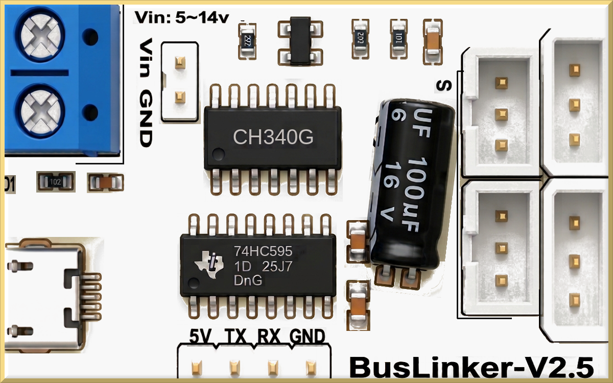

# Hiwonder BusLinker V2.5 — Fritzing part

Fritzing part for the **Hiwonder BusLinker V2.5** (a.k.a. *Hiwonder TTL/USB Debugging Board*),
the USB-to-TTL bus servo controller used with **Hiwonder / LewanSoul LX-series serial bus servos**
(LX-16A, LX-224, LX-15D, HTD/HTS series…).

## Download

[`hiwonder-buslinker-v2.5.fzpz`](hiwonder-buslinker-v2.5.fzpz)

## Installation

1. Download the `.fzpz` file.
2. In Fritzing: **File → Open** (or drag & drop the file onto the Parts bin).
3. Search for `BusLinker`, or import it into **MINE** (My Parts) via *Import…* so it is kept.

## Views

| View       | Provided |
|------------|----------|
| Breadboard | Yes (realistic board image) |
| Schematic  | Yes |
| PCB        | Yes (footprint) |
| Icon       | Yes |

## Connectors

| Group            | Pins                          |
|------------------|-------------------------------|
| Power input      | `Vin`, `GND`                  |
| Bus servo ports  | `Vout`, `Signal`, `GND` (×4)  |
| USB / TTL        | `USB_5V`, `Tx`, `Rx`, `USB_GND` |

## Compatibility

- Fritzing 0.9.x / 1.0.x
- Hiwonder BusLinker V2.5 board — [product page](https://www.hiwonder.com/products/hiwonder-ttl-usb-debugging-board)

## Keywords

Hiwonder, BusLinker, BusLinker V2.5, Hiwonder TTL/USB Debugging Board, LewanSoul, Lewansoul LX-16A,
LX-224, LX-15D, serial bus servo, bus servo controller, bus servo debugging board, TTL servo,
half-duplex UART, USB to TTL, USB-to-serial adapter, servo ID, servo firmware calibration,
Fritzing part, fzpz, Arduino, Raspberry Pi, robotics, robot arm, hexapod

## Author & License

Part by **MrJ** ([HO44-PROJECT on GitHub](https://github.com/HO44-PROJECT)). Questions or corrections: [open an issue](https://github.com/HO44-PROJECT/mrj-fritzing-parts/issues). Released under [CC0 1.0](../../../LICENSE).
Hiwonder and LewanSoul are trademarks of their respective owners; this part is unofficial and not affiliated with them.
